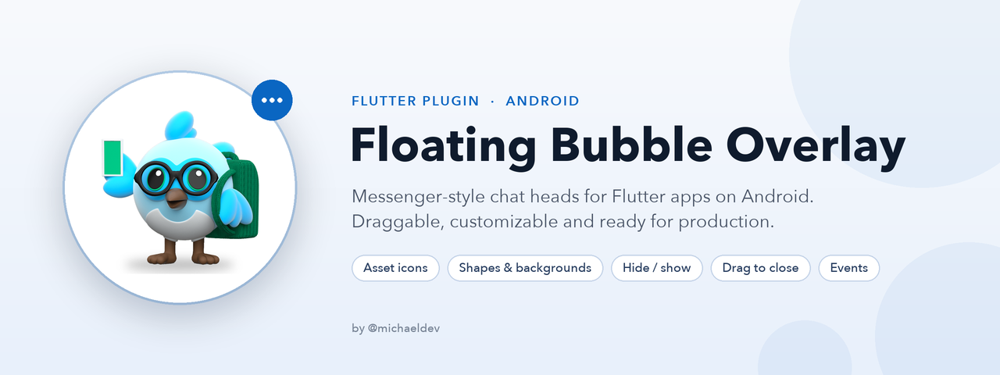
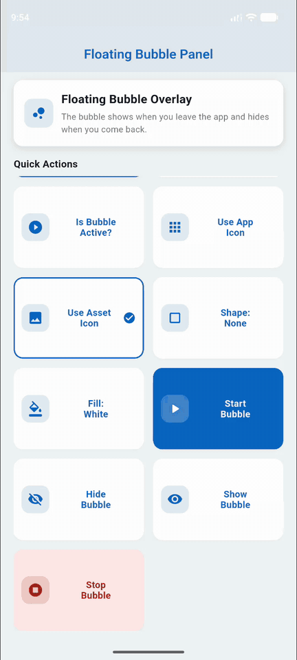

<picture>
  <source media="(prefers-color-scheme: dark)" srcset="https://raw.githubusercontent.com/VMichael1999/floating_bubble_overlay/main/doc/banner_dark.png">
  
</picture>

<h2 align="center">
  Floating Bubble Overlay
</h2>

<p align="center">
  <a href="https://pub.dev/packages/floating_bubble_overlay"></a>
  <a href="https://pub.dev/packages/floating_bubble_overlay/score"></a>
  <br>
  <a href="https://github.com/VMichael1999/floating_bubble_overlay/actions/workflows/ci.yml"></a>
  <a href="https://codecov.io/gh/VMichael1999/floating_bubble_overlay"></a>
  <a href="LICENSE"></a>
  
  
</p>

<p align="center">
  <b>English</b> · <a href="README.es.md">Español</a>
</p>

---

## 💡 Overview

**Floating Bubble Overlay** is a Flutter plugin that shows a floating bubble (chat head) on top of other apps, like Facebook Messenger.
It is built on top of [Floating-Bubble-View](https://github.com/TorryDo/Floating-Bubble-View).

- 👆 **Tap** the bubble → brings your app to the foreground (configurable with `openAppOnTap`)
- ✋ **Drag** the bubble → shows a close "X" zone (`following` or `fixed`)
- 🖼 **Icons from your Flutter `assets/`** or Android drawables (falls back to your app icon)
- 🎨 **Optional background** behind the icon: circle, square or rounded square, with a color, an image and a border
- ❌ **Customizable close button**: image, size, tint color and background
- 👁 **Hide / show** the bubble without stopping the service
- 🔔 **Events**: tap, tap down / up, move and **close by the user**
- 🛎 **Silent foreground notification** that opens your app, with an optional **"Stop" button**
- ♻️ **Survives process death**: if Android kills your app, the bubble comes back by itself

> **Note:** Only **Android** is supported (API 21+). On iOS / web / desktop every method simply returns `false`.

<br>

<p align="center">

</p>

---

## 🔧 Setup

```yaml
dependencies:
  floating_bubble_overlay: ^1.1.1
```

Android `minSdk` must be **21** or higher.

The plugin's manifest already declares everything it needs, so you **do not** have to add anything to your `AndroidManifest.xml`:

- `SYSTEM_ALERT_WINDOW`, `POST_NOTIFICATIONS`, `FOREGROUND_SERVICE`, `FOREGROUND_SERVICE_SPECIAL_USE`
- the `BubbleService` foreground service (`foregroundServiceType="specialUse"`, with the subtype property required by Android 14+)

### Icons

You can use either a **Flutter asset** or an **Android drawable**:

```yaml
# pubspec.yaml
flutter:
  assets:
    - assets/bubble.png
    - assets/close.png
```

```dart
const BubbleOptions(
  bubbleIconAsset: 'assets/bubble.png', // Flutter asset (recommended)
  closeIconAsset: 'assets/close.png',
)
```

Drawables are referenced by name, without extension, and live in your **app** (`android/app/src/main/res/drawable/my_bubble.png` → `bubbleIcon: 'my_bubble'`).
If an icon cannot be loaded, the app icon (or a default close icon) is used and a warning is logged.

### Background (shape, color, image)

By default the icon is drawn as is, so a transparent PNG shows only the artwork.
Add a `BubbleBackground` to draw it on a shape:

```dart
const BubbleOptions(
  bubbleIconAsset: 'assets/bubble.png',
  bubbleBackground: BubbleBackground(
    shape: BubbleShape.circle,          // circle, square, roundedSquare
    color: Color(0xFF0A66C2),           // fill color
    // imageAsset: 'assets/bg.png',     // or a background image (cropped to fill)
    padding: 6,                         // space around the icon (dp)
    borderColor: Color(0xFFFFFFFF),     // optional border
    borderWidth: 2,
  ),
  // closeIconBackground: BubbleBackground(...) works the same for the close icon.
)
```

| Option | Description | Default |
|---|---|---|
| `shape` | `BubbleShape.circle`, `square` or `roundedSquare` | `circle` |
| `color` | Fill color | none |
| `imageAsset` | Flutter asset drawn as the background, cropped to fill the shape (over `color`) | none |
| `padding` | Space between the edge and the icon (dp) | `6` |
| `cornerRadius` | Corner radius for `roundedSquare` (dp) | `12` |
| `borderColor` / `borderWidth` | Border (dp); none when the color is `null` or the width is `0` | none / `0` |

### Close button

The "X" shown while dragging is customizable too: use an image (`closeIconAsset` / `closeIcon`), recolor the default "X" with `closeIconColor`, and/or draw it on a `closeIconBackground`:

```dart
const BubbleOptions(
  closeIconColor: Color(0xFFFFFFFF),        // white "X"...
  closeIconBackground: BubbleBackground(    // ...on a red circle
    color: Color(0xFFD32F2F),
    padding: 4,
  ),
  closeIconSize: 56,
)
```

> The notification `icon` must be a drawable. Android draws small notification icons as a **white silhouette**, so use a monochrome icon with transparency.

---

## 💻 Usage

```dart
import 'package:floating_bubble_overlay/floating_bubble_overlay.dart';

final bubble = FloatingBubbleOverlay.instance;

// 1. Permissions
if (!await bubble.hasOverlayPermission()) {
  await bubble.requestOverlayPermission(); // opens the system settings screen
}
await bubble.requestPostNotificationsPermission(); // Android 13+

// 2. Start
final started = await bubble.startBubble(
  bubbleOptions: const BubbleOptions(
    bubbleIconAsset: 'assets/bubble.png',
    closeIconAsset: 'assets/close.png',
    bubbleSize: 60,
    closeIconSize: 56,
    closeBehavior: CloseBehavior.following,
  ),
  notificationOptions: const NotificationOptions(
    title: 'Bubble is running',
    body: 'Tap to open the app',
    showStopAction: true,
    stopActionLabel: 'Close bubble',
  ),
  onTap: () => print('tapped'),
  onMove: (x, y) => print('moved to $x, $y'),
  onClose: () => print('the user closed the bubble'),
);

// 3. Hide / show without stopping the service
await bubble.hideBubble();
await bubble.showBubble();

// 4. Stop
await bubble.stopBubble();
```

`startBubble` returns `false` if the overlay permission is missing or the bubble is already running (the callbacks of the running bubble are kept).

### Recipe: show the bubble only while your app is in the background

```dart
class _MyState extends State<MyPage> with WidgetsBindingObserver {
  final bubble = FloatingBubbleOverlay.instance;

  @override
  void initState() {
    super.initState();
    WidgetsBinding.instance.addObserver(this);
    bubble.hideBubble(); // the app may be cold-started by tapping the bubble
  }

  @override
  void didChangeAppLifecycleState(AppLifecycleState state) {
    if (state == AppLifecycleState.paused) {
      bubble.isRunning().then((running) =>
          running ? bubble.showBubble() : bubble.startBubble(/* ... */));
    }
    if (state == AppLifecycleState.resumed) bubble.hideBubble();
  }
}
```

The [example app](example/lib/main.dart) implements this pattern.

---

## 📡 Events

| Callback | When |
|---|---|
| `onTap` | The bubble is tapped |
| `onTapDown(x, y)` / `onTapUp(x, y)` | The bubble is pressed / released (coordinates in dp) |
| `onMove(x, y)` | The bubble is dragged |
| `onClose` | The **user** closes the bubble: dragging it to the "X" or with the notification stop button. Not called for `stopBubble()` |

Callbacks are delivered while your Flutter app is alive. If the bubble outlives the app (`keepAliveWhenAppExit: true`), events that happen after the app is closed are lost.

## 🧭 API

| Method | Description |
|---|---|
| `requestOverlayPermission()` / `hasOverlayPermission()` | "Display over other apps" permission |
| `requestPostNotificationsPermission()` / `hasPostNotificationsPermission()` | Notifications permission (Android 13+) |
| `startBubble(...)` / `stopBubble()` | Start / stop the bubble service |
| `hideBubble()` / `showBubble()` | Hide / show the bubble, keeping the service and its callbacks |
| `isRunning()` | Whether the service is running (visible or hidden) |
| `isBubbleVisible()` | Whether the bubble is running **and** visible |

## 🎨 BubbleOptions

| Option | Description | Default |
|-------|-------------|---------|
| `bubbleIconAsset` | Flutter asset used as the bubble icon | `null` |
| `bubbleIcon` | Drawable name of the bubble icon (if no asset) | app icon |
| `closeIconAsset` | Flutter asset used as the close icon | `null` |
| `closeIcon` | Drawable name of the close icon (if no asset) | system close icon |
| `bubbleSize` | Bubble width and height (dp), must be `> 0` | `60` |
| `closeIconSize` | Close icon width and height (dp) | `bubbleSize` |
| `bubbleBackground` / `closeIconBackground` | Optional [background](#background-shape-color-image) behind the icon | none |
| `closeIconColor` | Tint color for the close icon ([details](#close-button)) | none |
| `startLocationX` / `startLocationY` | Initial position (dp) | `0` / `200` |
| `opacity` | Transparency, `0.0` → `1.0` | `1.0` |
| `enableClose` | Show the close "X" while dragging | `true` |
| `closeBehavior` | `CloseBehavior.following` (X follows the bubble) or `CloseBehavior.fixed` (X fixed at the bottom) | `following` |
| `distanceToClose` | Distance (dp) at which the bubble snaps to the "X" | `100` |
| `enableAnimateToEdge` | Snap the bubble to the screen edge on release | `true` |
| `enableBottomShadow` | Gradient behind the close button | `true` |
| `keepAliveWhenAppExit` | Keep the bubble when the app is swiped away from recents | `false` |
| `openAppOnTap` | Bring the app to the foreground when the bubble is tapped | `true` |

## 🔔 NotificationOptions

| Option | Description | Default |
|---|---|---|
| `id` | Notification id | `101` |
| `title` / `body` | Texts of the notification | app name / none |
| `icon` | Drawable name of the small icon | app icon |
| `channelId` / `channelName` | Notification channel | `bubble_notification` / `Bubble Notification` |
| `showStopAction` | Show a button that closes the bubble (triggers `onClose`) | `false` |
| `stopActionLabel` | Label of that button | `Stop` |

Tapping the notification opens your app. The channel is created with **low importance** (no sound, no pop-up).
Android does not let apps change the importance of an existing channel: if a previous version of your app already created the channel, use a new `channelId`.

---

## 🏪 Publishing to Google Play

The plugin uses two capabilities that Google Play reviews:

1. **`SYSTEM_ALERT_WINDOW`** ("display over other apps"): explain in your store listing / in-app why your app shows a bubble, and ask for it only when the user enables the feature.
2. **Foreground service type `specialUse`** (Android 14+): in Play Console → *App content* → *Foreground service permissions*, declare the special use and describe the bubble feature (a short video helps the review).

---

## ❓ Troubleshooting

- **`startBubble` returns `false`** → the overlay permission is not granted, or the bubble is already running (check `isRunning()`).
- **The icon is the app icon** → the asset is not declared in `pubspec.yaml` or the drawable name is wrong; look for `FLOATING_BUBBLE_OVERLAY` warnings in logcat.
- **The notification makes a sound** → the channel was created by an older version; change `channelId`.
- **No callbacks after reopening the app** → callbacks belong to the Flutter app that called `startBubble`; call it again or keep the app alive.

---

## 📱 Compatibility

| Platform | Support |
|---------|---------|
| Android 5.0+ (API 21+) | ✔ — tested on an API 37 emulator with 16 KB page size (Pixel 10 Pro XL) |
| iOS / Web / Desktop | ❌ methods return `false` |

---

## 🧑‍💻 Author

Developed and maintained by **Michael Anthony Valdiviezo Maza**.
Licensed under the MIT license. Built on [Floating-Bubble-View](https://github.com/TorryDo/Floating-Bubble-View) by TorryDo.
